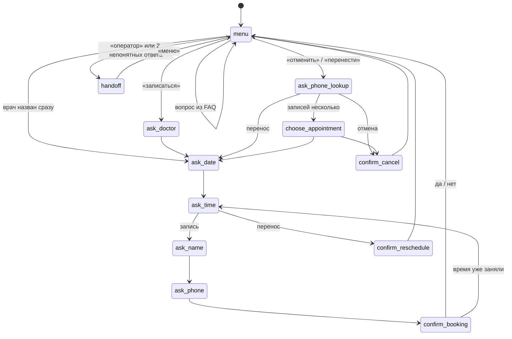

# Ассистент клиники

Текстовый ассистент медицинской клиники на JavaScript: записывает к врачу, отменяет и переносит запись, отвечает на частые вопросы и передаёт разговор администратору, если не может помочь.

Работает в браузере и в терминале: логика диалога одна, интерфейсы разные. Внешних зависимостей нет — только JavaScript и встроенные модули Node.js.

> Клиника, врачи, адрес и расписание вымышленные.

## Возможности

| Сценарий | Что умеет ассистент |
|---|---|
| Запись к врачу | врач → дата → свободное время → имя → телефон → подтверждение |
| Отмена записи | поиск записей по телефону, выбор, если записей несколько, подтверждение |
| Перенос записи | поиск по телефону → новая дата и время → подтверждение |
| Справки (FAQ) | адрес, часы работы, цены, подготовка к анализам — в любой момент разговора, без потери введённых данных |
| Передача оператору | по просьбе («позовите администратора») или после двух непонятных ответов подряд; оператор получает историю переписки |

Ассистент понимает свободные формулировки:
- **даты**: «завтра», «послезавтра», «в пятницу», «5 ноября», «05.11», «05.11.2026»;
- **время**: «10», «10:30», «в 3 дня»;
- **врачей** с опечатками: «нивроллогу» → невролог, «болит зуб» → стоматолог;
- **телефоны** в любом виде: «8 (912) 345-67-89», «+7 912 345 67 89».

Проверки: прошедшие даты, выходные, запись не дальше чем на 14 дней вперёд, только свободное время. Если время заняли, пока человек подтверждал запись, ассистент предлагает выбрать другое.

## Пример диалога

```
Ассистент: Чем могу помочь?
Вы: хочу к неврологу
Ассистент: На какую дату записать к неврологу? Ближайшие свободные дни: 28.10 (ср), 29.10 (чт), 30.10 (пт).
Вы: в субботу
Ассистент: 31.10 — суббота, клиника не работает.
Вы: завтра
Ассистент: Свободное время на 28.10 (ср): 09:00, 09:30, 10:00, ...
Вы: а какой у вас адрес?
Ассистент: Мы находимся по адресу: ул. Садовая, д. 15...
Ассистент: Свободное время на 28.10 (ср): 09:00, 09:30, 10:00, ... Какое время удобно?
Вы: 10:30
...
Ассистент: Готово! Вы записаны: 28.10 (ср) в 10:30 — невролог, Иванов А. П.
```

## Как устроен диалог

Диалог — конечный автомат: ассистент всегда находится в одном состоянии и по ответу пользователя переходит в следующее.



На любом шаге работают команды «меню» (начать заново) и «оператор», а вопросы из FAQ получают ответ без потери уже введённых данных.

## Структура

```
src/
  assistant.js        логика диалога: шаги, переходы, обработка ошибок
  parsers.js          разбор ответов: даты, время, телефон, имя, врач, да/нет
  booking-service.js  «внешняя система» записи с асинхронным API
  clinic-data.js      данные клиники: врачи, расписание, FAQ
  dates.js            работа с датами
web/
  app.js, style.css   веб-интерфейс чата
index.html            страница чата
cli.js                терминальная версия
server.js             мини-сервер для веб-версии
tests/                автоматические тесты (node:test)
```

**Интеграция.** Ассистент работает с записью только через асинхронные методы `BookingService` (`getFreeSlots`, `book`, `findByPhone`, `cancel`, `reschedule`). В проекте сервис хранит данные в памяти, но его можно заменить клиентом настоящего API медицинской системы, не меняя логику диалога. Передача оператору вызывает колбэк `onHandoff` с историей переписки — туда подключается CRM или чат операторов.

**Настройка под другого клиента** — только в `clinic-data.js`: врачи, ключевые слова, расписание, ответы FAQ.

## Запуск

Нужен [Node.js](https://nodejs.org) версии 20 или новее.

```bash
npm start        # терминальная версия
npm run web      # веб-версия: откройте http://localhost:3000
npm test         # тесты
```

Для проверки отмены и переноса есть демо-номер с двумя готовыми записями: **+7 900 123-45-67**.

## Тесты

28 тестов на встроенном `node:test`:
- разбор дат, времени, телефонов, имён, врачей с опечатками, ответов «да/нет»;
- сервис записи: расписание, выходные, занятое время, отмена, перенос;
- полные сценарии диалога: запись, отмена, перенос, вопрос посреди сценария, «время заняли во время оформления», передача оператору.

Время в тестах зафиксировано, поэтому результат не зависит от дня запуска.

## Что можно добавить

- голосовой ввод и вывод (Web Speech API);
- подключение к настоящему API расписания;
- распознавание намерений с помощью LLM для сложных формулировок;
- напоминание о приёме за день до визита.
